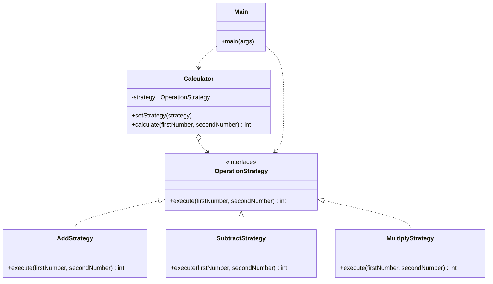

# Assignment 5 - Strategy Pattern

## 1. Introduction

The chosen domain is a Calculator (Option B).
The algorithm family is arithmetic operations: addition, subtraction and multiplication.
A `Calculator` (Context) performs an operation using an interchangeable strategy.
The strategy can be changed at runtime.

## 2. UML class diagram



## 3. Clean Code section

### 3.1 Polymorphism instead of conditional logic

Before (chain of conditionals):

```java
public int calculate(String operation, int a, int b) {
    if (operation.equals("add")) {
        return a + b;
    } else if (operation.equals("subtract")) {
        return a - b;
    } else {
        return a * b;
    }
}
```

After (delegation to the strategy):

```java
public int calculate(int firstNumber, int secondNumber) {
    return strategy.execute(firstNumber, secondNumber);
}
```

Justification: the Context has no `if` or `switch`. The choice of algorithm is made by the object that is passed in.

### 3.2 Meaningful, intention-revealing names

```java
public class AddStrategy implements OperationStrategy {

    public int execute(int firstNumber, int secondNumber) {
        return firstNumber + secondNumber;
    }
}
```

Justification: `AddStrategy`, `execute`, `firstNumber` and `secondNumber` explain themselves, so no comments are needed. Short names like `a` and `b` are avoided.

### 3.3 Single Responsibility

```java
public class MultiplyStrategy implements OperationStrategy {

    public int execute(int firstNumber, int secondNumber) {
        return firstNumber * secondNumber;
    }
}
```

Justification: each strategy does exactly one operation. It does not print, read input or choose anything.

### 3.4 Context is algorithm-agnostic

```java
public class Calculator {

    private OperationStrategy strategy;

    public Calculator(OperationStrategy strategy) {
        this.strategy = strategy;
    }
}
```

Justification: `Calculator` depends only on the `OperationStrategy` interface. It knows nothing about `AddStrategy`, `SubtractStrategy` or `MultiplyStrategy`.

### 3.5 Easy extensibility (Open/Closed)

Adding a new operation requires only one new class:

```java
public class MaxStrategy implements OperationStrategy {

    public int execute(int firstNumber, int secondNumber) {
        return Math.max(firstNumber, secondNumber);
    }
}
```

Usage in the client:

```java
calculator.setStrategy(new MaxStrategy());
```

Justification: `Calculator`, `OperationStrategy` and the other strategies are not modified.

## 4. Strategy vs. State

This problem calls for Strategy because the client chooses the algorithm from outside.
The operations are independent and do not know about each other.
The Calculator has no internal condition that changes its behavior.
In the State pattern the object changes its behavior by itself when its internal state changes, and states often switch to each other.
Here nothing like that happens: the client simply replaces one interchangeable algorithm with another.

## 5. Conclusion

The Strategy pattern added four classes: one interface and three strategies.
In return, the Calculator has no conditional logic, and new operations can be added without changing existing code.
For a small program this is more classes, but the code is easier to read, test and extend.

## 6. GitHub repository

https://github.com/sultanalibaltabai-alt/SDPAssignment5

Sources: Freeman & Robson, Head First Design Patterns (2nd ed.), Ch. 1; Martin, Clean Code, Ch. 10; refactoring.guru/design-patterns/strategy.